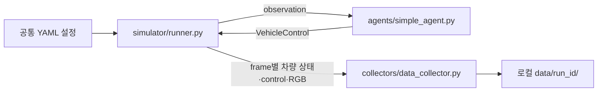

# ROBO404 DataOps — CARLA 공통 개발 환경

각자 PC에서 CARLA를 실행하고, 같은 map·날씨·timestep·차량·센서 규격으로 개발하기 위한 저장소입니다.
아래 순서대로 진행하면 Python 환경 설치와 CARLA 연결, 공통 월드 설정을 확인할 수 있습니다.
공통 환경 설정을 마치면, 그 뒤에 주행 로직과 데이터 수집 코드를 작성해보며 환경을 익히시면 됩니다.

## 구조

```text
robo404-dataops/
├── config/           # 팀 공통 simulation·sensor 규격
├── scripts/          # 설정 로딩과 환경·연결·월드 검증
├── tests/            # 오프라인 테스트
├── docs/             # 추가 안내
├── requirements.txt
├── .gitignore
└── README.md
```


## 1. CARLA 다운로드 및 서버 실행

이미 CARLA 0.9.16을 설치했다면 다운로드는 건너뛰고 서버를 실행합니다.

1. [공식 CARLA 0.9.16 release](https://github.com/carla-simulator/carla/releases/tag/0.9.16)에서 Windows 패키지를 다운로드합니다.
2. 예를 들어 `C:\CARLA_0.9.16`에 압축을 해제합니다. CARLA는 이 저장소 밖에 설치합니다.
3. 해당 폴더의 `CarlaUE4.exe`를 실행하거나 PowerShell에서 실행합니다.

```powershell
cd C:\CARLA_0.9.16
.\CarlaUE4.exe
```


## 2. Python 가상환경 생성 및 의존성 설치

```powershell
py -3.11 -m venv .venv
.\.venv\Scripts\python.exe -m pip install -r requirements.txt
```

`.venv`는 각자 PC에서 만듭니다. 다른 사람의 가상환경을 복사하지 않습니다.
이미 `.venv`가 있다면 아래 명령으로 Python 3.11인지 확인하고 맞는 환경을 재사용합니다.

```powershell
.\.venv\Scripts\python.exe --version
```

현재 설치하는 패키지는 `carla==0.9.16`, `PyYAML==6.0.3`입니다.
명령에서 `.venv`의 Python을 직접 호출하므로 별도로 가상환경을 activate할 필요는 없습니다.


## 3. CARLA 연결 확인

2단계에서 실행한 CARLA server가 켜져 있는지 확인한 뒤 실행합니다.

```powershell
.\.venv\Scripts\python.exe -m scripts.check_connection
```

`client_version`과 `server_version`이 모두 `0.9.16`이고, 현재 map과 **`Connection OK`**가 출력되면 성공입니다.
이 명령은 서버의 현재 상태를 조회하며 map이나 settings를 변경하지 않습니다.
여기서 조회된 map이 Town03이 아니어도 연결은 정상일 수 있습니다.

## 4. 공통 월드 설정 확인

```powershell
.\.venv\Scripts\python.exe -m scripts.check_world --apply
```

검사 내용은 다음과 같습니다.

- Town03을 로드하고 공통 weather·synchronous mode·timestep·seed를 적용합니다.
- 사용할 차량 blueprint와 spawn index가 유효한지 확인합니다.
- Simulation을 10 ticks 진행하고 적용된 map·weather·timestep을 확인합니다.
- 종료 시 로드한 map의 변경 전 settings와 weather를 복원합니다.

**`World check OK`**와 `"settings_and_weather_restored": true`가 출력되면 공통 월드 설정 검증에 성공한 것입니다.
차량이나 camera는 생성하지 않으므로 새 차량이 나타나지 않는 것이 정상입니다.
Town03은 로드된 상태로 남고, 이전 map과 actor는 복원되지 않습니다.

검사 종료 후 synchronous mode와 weather를 계속 유지하는 도구가 아니므로,
이후 작성하는 실습 프로그램은 공유 설정을 다시 읽어 적용해야 합니다.

## 5. 공통 설정 파일 확인


| 파일 | 역할 |
|---|---|
| [config/simulation.yaml](config/simulation.yaml) | Server, world, ego, 월드 검증 설정 |
| [config/sensors.yaml](config/sensors.yaml) | RGB camera 규격 |
| [requirements.txt](requirements.txt) | Python 의존성 버전 |

현재 설정한 공통 값은 다음과 같습니다.

| 항목 | 값 |
|---|---|
| Server | `127.0.0.1:2000` |
| Map / weather | `Town03` / `ClearNoon` |
| Synchronous mode / timestep | `true` / `0.05`초 |
| Seed | `42` |
| Ego blueprint / spawn index | `vehicle.tesla.model3` / `0` |
| RGB 해상도 / FOV | `800×600` / `90`도 |
| RGB sensor tick | `0.05`초 |
| Camera 부착 pose | `config/sensors.yaml`의 `transform` 참고 |

공통값 변경은 팀에서 합의한 뒤 반영합니다.
YAML은 규격을 정의한 파일이며, 파일을 내려받거나 수정하는 것만으로 CARLA에 자동 적용되지는 않습니다.
각자 작성하는 프로그램이 설정을 읽고 API에 적용해야 합니다.

설정 로딩과 검증은 다음 함수를 재사용할 수 있습니다.

```python
from scripts.settings import load_settings

config = load_settings()
```

## 6. 직접 구현하기

환경 검증을 마쳤다면 **차량 생성 → Python 제어 → camera 연결 → 데이터 저장** 순서로 구현합니다.


```text
robo404-dataops/
├── config/                    # 기존 공통 설정 사용
├── scripts/                   # 기존 환경 검증 도구 유지
├── simulator/                 # 직접 작성: CARLA 실행 흐름
│   ├── __init__.py
│   ├── connection.py
│   ├── setup_world.py
│   ├── actors.py
│   └── runner.py
├── agents/                    # 직접 작성: 주행 판단
│   ├── __init__.py
│   ├── base_agent.py
│   └── simple_agent.py
├── collectors/                # 직접 작성: 수집·저장
│   ├── __init__.py
│   └── data_collector.py
└── tests/                     # 기존 테스트 + 구현한 기능의 테스트
```


| 작성할 파일 | 이 파일에서 구현할 내용 | 담당하는 기능 |
|---|---|---|
| `simulator/connection.py` | 공통 host/port로 client 생성, timeout 설정, client/server 버전 확인 | CARLA server에 연결합니다. 기존 `scripts/check_connection.py`의 연결 부분을 참고할 수 있습니다. |
| `simulator/setup_world.py` | map 로드, weather·sync·timestep·seed 적용, 변경 전 settings 보관과 복원 | 실행할 월드를 공통 조건으로 준비합니다. 차량 제어는 넣지 않습니다. |
| `simulator/actors.py` | ego blueprint·spawn index로 차량 생성, 공통 RGB 설정으로 camera 생성·부착, 생성한 actor 추적 | 차량과 sensor를 만들고 정리할 수 있도록 handle을 반환합니다. |
| `agents/base_agent.py` | agent가 받을 observation과 반환할 control의 공통 약속 정의 | 예를 들어 `run_step(observation)`이 `carla.VehicleControl`을 반환하도록 맞춥니다. |
| `agents/simple_agent.py` | observation을 받아 throttle·steer·brake 결정 | 처음에는 짧은 고정 throttle 주행부터 확인하고, 이후 PID나 waypoint 주행으로 발전시킵니다. |
| `collectors/data_collector.py` | frame별 차량 상태·control·sensor 정보 기록, 로컬 파일 저장, 저장 종료 처리 | agent 종류와 관계없이 동일한 형식으로 데이터를 저장합니다. 주행 판단은 넣지 않습니다. |
| `simulator/runner.py` | 설정 로딩, 연결, 월드 준비, actor 생성, agent 호출, control 적용, tick 진행, collector 호출, 종료 시 정리 | 위 모듈을 연결하는 실행 진입점입니다. 주행 판단과 파일 저장의 세부 구현은 각 담당 모듈에 둡니다. |




